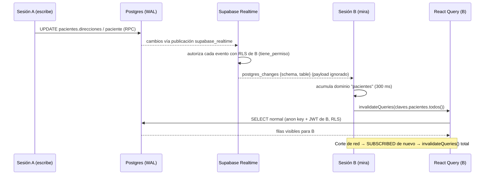

## Context

Ver `proposal.md` §Why. Estado actual relevante:

- **Toda** lectura de datos pasa por React Query (directo o vía `shared/lib/query/useListaDeDominio.ts` / `shared/lib/paginacion/usePaginaListado.ts`).
- Las claves se construyen SOLO en `frontend/src/shared/lib/query/claves.ts`, con jerarquía `[dominio] → [dominio, 'lista'|'pagina'|'deFecha'|…]`. React Query invalida por prefijo: `claves.X.todos()` alcanza todas las variantes del dominio. Las mutaciones locales ya invalidan así.
- `App.tsx`: `QueryClientProvider > AuthProvider > RouterProvider`. `AuthContext` expone `status: 'loading' | 'anonymous' | 'authenticated'` + `usuario`.
- Cliente único `frontend/src/shared/lib/supabaseClient.ts` con anon key.
- RLS: todas las tablas candidatas tienen `ENABLE ROW LEVEL SECURITY` y policies `FOR SELECT TO authenticated USING (modulos.tiene_permiso('<modulo>','read'))`; los esquemas custom (`pacientes`, `conductores`, `facturacion`, `obra_social`) tienen `GRANT USAGE` + `GRANT ALL ON ALL TABLES` a `authenticated` — requisito de Realtime para esquemas no-`public`.
- Las escrituras llegan por tres caminos: PostgREST directo, RPC (`crear_*_completo`, `actualizar_*_completa`) y Edge Functions (`presupuestos`, `vehiculos`, `autorizaciones`…). Realtime lee el WAL, así que los tres disparan eventos por igual, sin tocar ningún escritor.

## Goals / Non-Goals

**Goals:**
- Un único punto de suscripción; cero cambios en pantallas/hooks de dominio.
- RLS del SELECT normal sigue siendo la única fuente de verdad de qué dato ve cada quien.
- Testeable sin sockets reales.

**Non-Goals:**
- Aplicar el payload a la caché (`setQueryData`) — nunca.
- Resolver conflictos de edición concurrente (last write wins, igual que hoy).
- Presencia, avisos visuales "otro usuario editó", tracking GPS (ver proposal).
- Invalidación fina por id (`deFecha(x)`, `dePaciente(y)`): se invalida el dominio entero; a esta escala el refetch extra es despreciable.

## Decisions

### D1 — Invalidar-y-releer, nunca renderizar el payload
El callback del evento ignora `new`/`old` y solo usa `schema` + `table` para decidir qué dominio invalidar.
**Por qué:** (a) el SELECT de cada repositorio arma la forma de dominio (joins, mapeos) que el payload crudo no tiene; (b) RLS/columnas visibles los decide el SELECT, no el evento; (c) los DELETE solo traen la PK (ver D2) — con invalidar alcanza.
**Alternativa descartada:** `setQueryData` con el payload — duplicaría los mapeos de cada repositorio y abriría la puerta a mostrar datos sin pasar por el camino normal.

### D2 — `postgres_changes` sobre publicación `supabase_realtime`, autorizado por RLS
Verificado en la doc de Supabase (Realtime › Postgres Changes, 2026-10):
- "Postgres Changes authorizes every event against each subscriber" → un INSERT/UPDATE solo llega a quien pasa la policy de SELECT de esa fila (`tiene_permiso` funciona porque Realtime evalúa con los claims del JWT del suscriptor, `auth.uid()` incluido).
- Esquemas privados: "You can listen to tables in your private schemas by granting table SELECT permissions" → ya está (ver Context).
- "RLS policies are not applied to DELETE statements" → un DELETE llega a todo suscriptor de la tabla, **solo con la PK** (no seteamos `REPLICA IDENTITY FULL`, así `old` queda en la PK). Exposición: un UUID opaco, sin datos de salud. Aceptable; y como solo invalidamos, un usuario sin permiso que recibe un DELETE hace un no-op (no tiene esas queries en caché, o si las tiene, el refetch vuelve filtrado por RLS).
- Sesión: supabase-js v2 propaga el access token al socket de Realtime en login/refresh (`realtime.setAuth`) automáticamente. Solo se usa el cliente anon de `supabaseClient.ts`; **nunca** service role.
**Alternativa descartada:** *Broadcast from Database* (triggers + `realtime.send` + canales privados con RLS sobre `realtime.messages`). Escala mejor y permite payloads mínimos, pero agrega un trigger por tabla + policies nuevas: más superficie de migración para 2–3 usuarias. Revisitar si crece el número de sesiones simultáneas.

### D3 — Qué tablas entran (mapeo tabla → dominios)
Criterio: datos operativos que dos personas miran a la vez durante el día, incluyendo las sub-tablas que una sola edición toca (la ficha de paciente actualiza `direcciones`/`cud`/… sin tocar necesariamente `paciente`).

| Tabla | Invalida `claves.*.todos()` |
|---|---|
| `pacientes.hoja_de_ruta` | `hojasDeRuta` |
| `pacientes.recorrido` | `hojasDeRuta` |
| `pacientes.historial_recorridos` (paradas) | `hojasDeRuta` |
| `pacientes.recorridos` (habituales) | `recorridosHabituales` |
| `pacientes.paciente` | `pacientes` |
| `pacientes.direcciones`, `pacientes.cud`, `pacientes.clinicos`, `pacientes.personas_a_cargo`, `pacientes.prestaciones`, `pacientes.accesorios_pacientes` | `pacientes` |
| `obra_social.coberturas_paciente` | `pacientes` |
| `conductores.vehiculo`, `conductores.mantenimiento`, `conductores.habilitaciones_vehiculo`, `conductores.accesorios_vehiculo` | `vehiculos` |
| `conductores.conductores` | `conductores` |
| `conductores.conductores_vehiculos` | `conductores`, `vehiculos` |
| `facturacion.presupuesto`, `facturacion.presupuesto_linea` | `presupuestos` |
| `facturacion.autorizacion` | `autorizaciones`, `presupuestos` (igual que `usePresupuestos` hoy) |

**Excluidas:**
- `auditoria.logs` — cada escritura genera una fila: duplicaría todo el tráfico y no tiene pantalla en vivo.
- `modulos.*`, `usuarios.usuarios` — permisos/cuentas: sensibles, cambian casi nunca, y un cambio de permisos ya exige re-login.
- `obra_social.obra_social`, `prestadores`, `requisitos_*`, `plantilla_campo`, `tipos_documento`, catálogos (`pacientes.accesorios`, `facturacion.tipos_documento`) — datos de referencia con `FRESCURA.referencia` (1 min) + refresco al enfocar alcanzan.
- `facturacion.facturas`, `cobros`, `asistencia_prestacion`, `documento_factura`, `gastos_vehiculos` — facturación es de una sola persona por vez y dominio CRÍTICO; queda como Open Question.
- `pacientes.documentos`, `conductores.documentacion_*` — checklists por entidad con clave propia (`refreshToken`) y archivos en Storage; fuera del v1.

El mapeo es **una constante tipada** (`TABLAS_REALTIME`) en `shared/lib/realtime/` que a la vez (a) define las suscripciones y (b) resuelve las claves. Un test de guarda lee la migración y exige que el set de tablas coincida exactamente con las claves del mapeo (mismo patrón que `repositorySourceGuards.test.ts`), para que publicación y frontend no diverjan.

### D4 — Puerto mínimo del canal, inyectable
El hook recibe una fábrica `crearCanal` que devuelve un objeto con `escuchar(schema, tabla, onCambio)`, `suscribir(onEstado)` y `cerrar()`. Producción: adaptador fino sobre `supabase.channel(...).on('postgres_changes', …)` / `supabase.removeChannel`. Tests: un fake en memoria que dispara eventos y estados a mano.
**Por qué:** los tests no deben abrir sockets y tipar un `SupabaseClient` falso sin `any` es frágil. Es la única abstracción del change y existe solo por testabilidad.
Un solo canal con N bindings (uno por tabla) — no un canal por tabla.

### D5 — Coalescencia de ráfagas
Los eventos se acumulan en un `Set` de dominios; un `setTimeout` de ~300 ms (constante) los vacía con un `invalidateQueries` por dominio. Guardar una ficha de paciente (≈6 tablas) produce **una** invalidación de `pacientes`.
**Alternativa descartada:** throttle / lib de debounce — innecesario, el `setTimeout` alcanza.

### D6 — Reconexión: invalidar todo
Ante `SUBSCRIBED` posterior a `CHANNEL_ERROR` / `TIMED_OUT` / `CLOSED`, se llama `queryClient.invalidateQueries()` sin filtro: lo que pasó durante el corte no se recupera de Realtime (no hay replay). El primer `SUBSCRIBED` no invalida (la pantalla acaba de cargar). La reconexión en sí la hace supabase-js.

### D7 — Ciclo de vida atado a la sesión
Componente `<SincronizacionRealtime />` dentro de `AuthProvider` (necesita auth y `queryClient`). El efecto depende de `status === 'authenticated'` y de `usuario.id`: logout → cleanup cierra el canal y cancela el timer pendiente; cambio de usuario → cierra y re-suscribe con el nuevo token. `StrictMode` monta/desmonta dos veces en dev: el cleanup debe ser idempotente.

### D8 — Escrituras propias
La sesión que escribe recibe su propio evento y re-invalida lo que su mutación ya invalidó: un refetch doble, inofensivo e intencionalmente no filtrado (filtrar requeriría marcar origen en cada escritor).

### D9 — Kill switch = una línea
Sin flag de entorno: deshabilitar es borrar `<SincronizacionRealtime />` de `App.tsx`. `refetchOnWindowFocus: true` queda como fallback permanente.

### Flujo

## Risks / Trade-offs

- [Un change futuro crea una tabla operativa y no la publica] → test de guarda D3 + nota en `CHANGES.md`. Afecta directamente a `viajes-tercerizados-hoja-de-ruta` (si crea `pacientes.recorrido_tercerizado` → agregar con dominio `hojasDeRuta`) y a `datos-paciente-por-anio` (`pacientes.paciente_anio` → `pacientes`). Quien archive segundo suma sus tablas al mapeo y a una migración nueva (no editar la de este change si ya se aplicó).
- [Conflicto de merge en `claves.ts`] → este change NO modifica `claves.ts`, solo lo importa.
- [Eventos perdidos durante corte de red] → D6 + `refetchOnWindowFocus`.
- [Carga de autorización: cada evento × cada suscriptor] → 2–3 sesiones, irrelevante. Si escala, migrar a Broadcast (D2).
- [DELETE visible sin RLS] → solo PK UUID, aceptado (D2). No activar `REPLICA IDENTITY FULL` en estas tablas.
- [Un usuario sin permiso de un módulo] → no recibe INSERT/UPDATE de ese módulo; los DELETE le producen invalidaciones no-op. Sin fuga de datos.
- [Refetch al volver de un corte en pantalla pesada] → aceptable; mismo costo que un F5 parcial.
- [Límites del plan Supabase] → 2–3 conexiones simultáneas, muy debajo de la cuota.

## Migration Plan

1. Deploy de la migración `ALTER PUBLICATION supabase_realtime ADD TABLE …` (sin efecto funcional hasta que haya suscriptores).
2. Deploy del frontend con `<SincronizacionRealtime />`.
3. Verificación manual: dos navegadores con la misma cuenta, editar en uno, ver el otro actualizarse sin foco; cortar red en uno y volver.

**Rollback:** quitar la línea en `App.tsx` (inmediato) y/o migración inversa `ALTER PUBLICATION supabase_realtime DROP TABLE …` (incluida comentada en la migración). Independientes entre sí.

## Open Questions

- ¿Sumar facturación (`facturas`, `cobros`) al v1? Hoy excluida (D3). Agregarla es una fila del mapeo + una línea de migración; no cambia el diseño.
- ¿`pacientes.clinicos` (dato clínico) debe viajar por Realtime? La exposición es igual al SELECT (RLS), pero se puede excluir por minimización; la contrapartida es que un cambio solo-clínico no se vería en vivo en la otra sesión.
